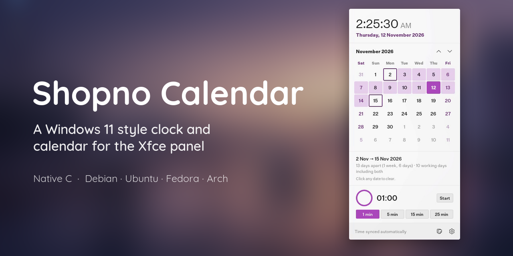
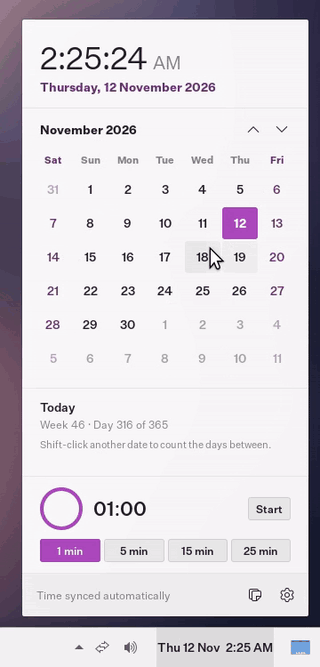
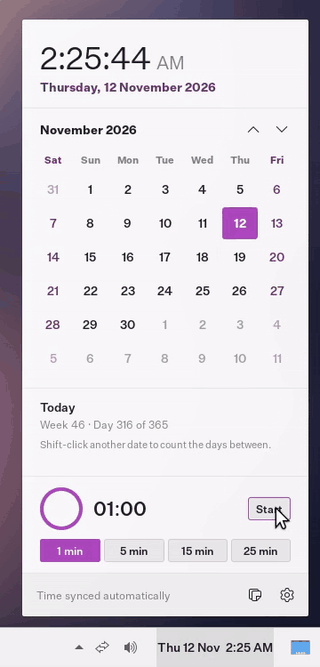
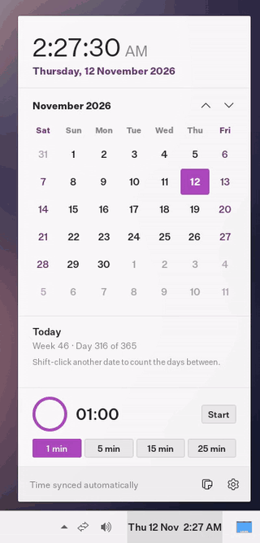
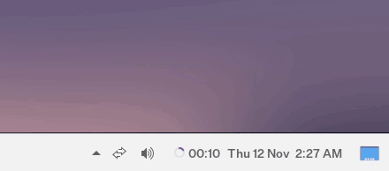
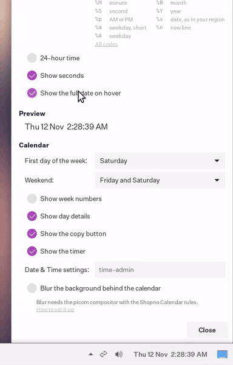
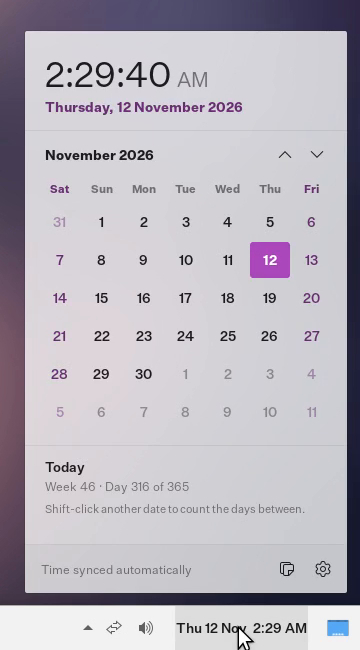
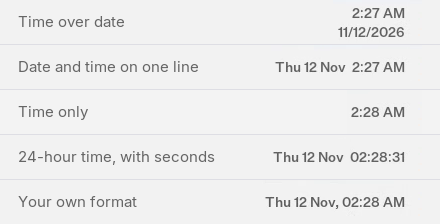
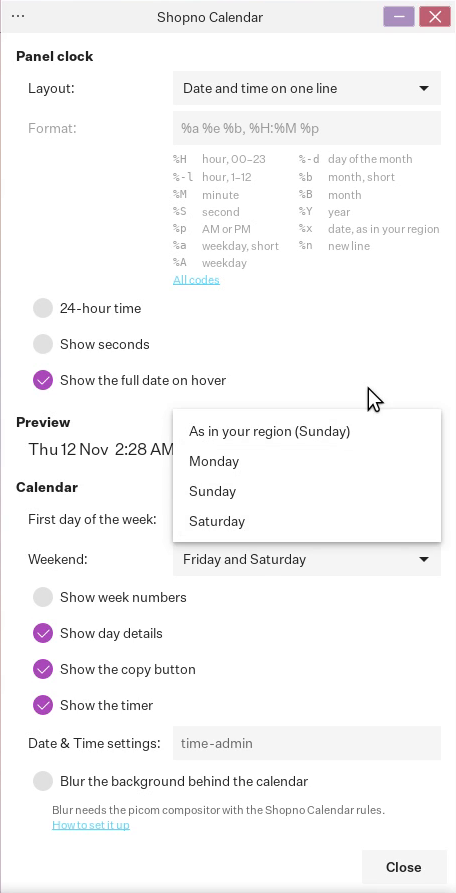

<p align="center">
  
</p>

<p align="center">
  <a href="https://github.com/fa-saikat/xfce4-shopno-calendar-plugin/releases/latest"></a>
  <a href="https://github.com/fa-saikat/xfce4-shopno-calendar-plugin/actions/workflows/build.yml"></a>
  
  <a href="COPYING"></a>
</p>

<p align="center">
  <a href="#features">Features</a> ·
  <a href="#options">Options</a> ·
  <a href="#keyboard">Keyboard</a> ·
  <a href="#installing">Install</a> ·
  <a href="#building">Build</a> ·
  <a href="#limitations">Limitations</a> ·
  <a href="#about-the-code">About the code</a> ·
  <a href="#credits">Credits</a>
</p>

## Why this exists

I'm building it for [ShopnoOS](https://github.com/fa-saikat/shopno-os), next to
[Shopno Menu](https://github.com/fa-saikat/xfce4-shopno-menu-plugin) and
[Shopno Quick Settings](https://github.com/fa-saikat/xfce4-shopno-quicksettings-plugin).
The calendar that comes with Xfce's Clock plugin is a plain `GtkCalendar` and
looks out of place next to them. Most of our users come from Windows, so
Shopno Calendar follows the Windows 11 clock and calendar flyout, and adds a
few things of its own.

It works on any distribution with Xfce 4.18 or newer.

## Features

<table>
  <tr>
    <td width="50%" valign="top">
      
      <p><b>Get anywhere fast.</b> The arrows or the mouse wheel change the month. Click the title for the months of the year, and again for the years of the decade.</p>
    </td>
    <td width="50%" valign="top">
      
      <p><b>Day details and the days between.</b> Pick a day for "In 6 days · Week 47 · Day 322 of 365". Shift-click a second day to count the days between, and the working days, which skip your weekend.</p>
    </td>
  </tr>
  <tr>
    <td valign="top">
      
      <p><b>A focus timer on the panel.</b> Pick 1, 5, 15 or 25 minutes, or scroll over the time for any length up to 4 hours. It keeps running when the calendar closes, with a ring and the time left next to the clock.</p>
    </td>
    <td valign="top">
      
      <p><b>Copy the date or time</b> as an ISO date, your region's date, the long date, the date and time, or Unix time. The footer confirms what was copied.</p>
    </td>
  </tr>
  <tr>
    <td colspan="2" valign="top">
      
      <p><b>Ends with a notification</b>, with a <b>Restart</b> button to run the timer again.</p>
    </td>
  </tr>
  <tr>
    <td valign="top">
      
      <p><b>Your week, your weekend.</b> Start the week on Monday, Sunday or Saturday, or as your region does. Tint the weekend your country keeps, and show ISO 8601 week numbers.</p>
    </td>
    <td valign="top">
      
      <p><b>Background blur</b> with picom, as in Shopno Menu and Shopno Quick Settings (see <a href="#background-blur">Background blur</a>).</p>
    </td>
  </tr>
</table>

Also:

- **Hover over the clock** for the full date, the week number and the day of
  the year, and the time left on the timer, without opening the calendar.
- **Clock sync status.** The footer shows whether the clock is synced
  automatically, as systemd-timedated reports it, with a warning when it isn't.
  The button next to it opens the system's Date & Time settings.
- **Today stands out** as a filled square, and every day is named for screen
  readers.
- **The clock is always right.** It changes exactly when the minute does, and
  shows the right time straight after a resume, a clock change or a new time
  zone.
- **Any panel.** The calendar opens next to the clock on any panel edge. On a
  vertical panel the text is turned; on a deskbar the date and time are
  stacked.
- Follows your **GTK theme**, light or dark.

### Panel clock

<p align="center">
  
</p>

Pick the time over the date, as in Windows 11, the date and time on one line,
the time only, or your own format with the same codes as Xfce's Clock plugin
(`%a %e %b, %H:%M`, say). 12 or 24-hour time follows your region until you
pick one, and seconds are optional.

## Options

Right-click the clock and choose **Properties**. Changes apply straight away,
with a preview of the panel clock.

<p align="center">
  
</p>

| Option | What it does | Default |
|---|---|---|
| **Layout** | Time over date, date and time on one line, time only, or a custom format | Time over date |
| **Format** | The custom format, with a list of the common codes and a link to all of them | `%a %e %b, %H:%M` |
| **24-hour time** | 24-hour instead of 12-hour time | As in your region |
| **Show seconds** | Seconds on the panel clock | Off |
| **Show the full date on hover** | The clock's tooltip with the full date, week number, day of the year and the timer | On |
| **First day of the week** | As in your region, Monday, Sunday or Saturday | As in your region |
| **Weekend** | Saturday and Sunday, Friday and Saturday, Friday, Sunday, or none. Tints those days and leaves them out of working days | Saturday and Sunday |
| **Show week numbers** | ISO 8601 week numbers to the left of the days | Off |
| **Show day details** | The selected day's details and the days between two dates, under the calendar | On |
| **Show the copy button** | The copy button in the footer | On |
| **Show the timer** | The focus timer and its ring on the panel | On |
| **Date & Time settings** | The command the settings button runs | `time-admin` |
| **Blur the background behind the calendar** | Background blur, with picom | Off |

The timer's length is remembered between sessions.

## Keyboard

The calendar works without a mouse.

| Key | In the calendar |
|---|---|
| Arrow keys | Move between days, into the next or previous month when needed |
| Shift + arrow keys | Move the end of a range, to count the days between |
| Page Up / Page Down | Previous or next month |
| Home | Back to today |
| Up / Down, + / − | On the timer's time, while it is stopped: a minute longer or shorter |
| Escape | Close the calendar |

A click outside the calendar, or another click on the clock, closes it too.

## Installing

Download the package for your distribution from the
[latest release](https://github.com/fa-saikat/xfce4-shopno-calendar-plugin/releases/latest),
then install it:

| Distribution             | File                         | Install with                                                |
|--------------------------|------------------------------|-------------------------------------------------------------|
| Debian 13                | `*.debian13_amd64.deb`       | `sudo apt install ./xfce4-shopno-calendar-plugin_*.deb`     |
| Ubuntu 24.04, Mint 22    | `*.ubuntu24.04_amd64.deb`    | `sudo apt install ./xfce4-shopno-calendar-plugin_*.deb`     |
| Fedora                   | `*.fc*.x86_64.rpm`           | `sudo dnf install ./xfce4-shopno-calendar-plugin-*.rpm`     |
| Arch Linux               | `*.pkg.tar.zst`              | `sudo pacman -U xfce4-shopno-calendar-plugin-*.pkg.tar.zst` |

Each release also has a `SHA256SUMS` file to check the downloads with
`sha256sum -c --ignore-missing SHA256SUMS`.

Then restart the panel (`xfce4-panel -r`), right-click it, choose
**Panel > Add New Items…**, and add **Shopno Calendar**. You can then remove
Xfce's own Clock.

Optional extras:

- [picom](https://github.com/yshui/picom) for
  [background blur](#background-blur).
- A Date & Time settings program for the settings button: `time-admin` from
  `gnome-system-tools`, or any command you set in Properties.
- systemd-timedated for the sync status. Without it, the footer leaves the
  status out.
- A notification daemon, such as `xfce4-notifyd`, for the timer's
  notification.

For other distributions, build from source as described below.

## Building

Dependencies:

| Library          | Minimum version |
|------------------|-----------------|
| GTK              | 3.24            |
| libxfce4panel    | 4.18            |
| libxfce4ui       | 4.18            |
| libxfce4util     | 4.18            |
| xfconf           | 4.18            |

You also need `meson` 0.62 or newer, `ninja`, a C compiler, and `gettext`.

**Debian / Ubuntu**

```sh
sudo apt install build-essential meson ninja-build gettext pkg-config \
  libgtk-3-dev libxfce4panel-2.0-dev libxfce4ui-2-dev libxfce4util-dev libxfconf-0-dev
```

**Fedora**

```sh
sudo dnf install gcc meson ninja-build gettext gtk3-devel \
  xfce4-panel-devel libxfce4ui-devel libxfce4util-devel xfconf-devel
```

**Arch Linux**

```sh
sudo pacman -S --needed base-devel meson gettext gtk3 xfce4-panel libxfce4ui libxfce4util xfconf
```

Build, test and install:

```sh
meson setup build --prefix=/usr
meson compile -C build
meson test -C build
sudo meson install -C build
```

The prefix must match the one Xfce is installed to (`/usr` on almost every
distribution), otherwise the panel will not find the plugin.

Then restart the panel with `xfce4-panel -r`, right-click the panel, choose
**Panel > Add New Items…**, and add **Shopno Calendar**.

## Background blur

Blur is drawn by the compositor, so it needs [picom](https://github.com/yshui/picom)
instead of the built-in Xfce compositor:

1. Turn off the Xfce compositor in **Settings > Window Manager Tweaks >
   Compositor**, and run picom with a blur method such as
   `blur-method = "dual_kawase";`.
2. Add the rules from [`extras/picom/shopno-calendar.conf`](extras/picom/shopno-calendar.conf)
   to your picom configuration. The packages also install them under
   `/usr/share/doc/xfce4-shopno-calendar-plugin/`.
3. Right-click the clock, choose **Properties**, and turn on **Blur the
   background behind the calendar**.

With blur off, the calendar draws its own rounded corners and works with
any compositor, or none.

## Theming

Colors come from your GTK theme. To change the layout or colors, override the
`.shopno-cal-*` CSS classes in `~/.config/gtk-3.0/gtk.css`. The default rules
are in [`src/resources/shopno-calendar.css`](src/resources/shopno-calendar.css).

## Limitations

- **No events or reminders.** It is a clock and calendar, not an agenda, and
  doesn't read calendars such as Google Calendar or Thunderbird.
- **One timer at a time**, up to 4 hours, with no alarms at a set time.
- **Fixed size.** The calendar can't be resized.
- **X11 only.** It has not been tested on Wayland.
- **Borrowed icon.** It uses the ShopnoOS logo until it has one of its own.

If one of these matters to you,
[open a feature request](https://github.com/fa-saikat/xfce4-shopno-calendar-plugin/issues/new/choose)
so I know what to do first.

## About the code

Shopno Calendar is AI-assisted. It was written with
[Claude](https://claude.ai) and directed, reviewed and tested by me. I decided
what it does and how it should look, checked each change before merging it,
and sent back what didn't work. After the first few commits, every change
went through its own issue and pull request, so the history shows how it was
built.

How it is checked today:

- CI builds the plugin with warnings as errors and runs the tests on
  Debian 13, Ubuntu 24.04, Fedora and Arch, and builds and install-tests the
  packages for each of them.
- The tests cover the month grid, week numbers and working days, the day
  details, the clock formats, the clock sync state and the timer, with fake
  timedated and notification servers on a private bus.
- Before 1.0.0, the plugin went through AddressSanitizer, LeakSanitizer,
  UBSan, valgrind, GCC's static analyzer and cppcheck, with a scripted session
  through every part of the calendar, plus 200 open-and-close cycles in a real
  panel while its memory was measured. Nothing leaked from the plugin's own
  code.

If you find something wrong in the code, please say so in an issue. It gets
the same attention as any other bug.

## Contributing

Bug reports, translations, and patches are welcome. See
[CONTRIBUTING.md](CONTRIBUTING.md).

## Credits

Shopno Calendar builds on:

- **Xfce**: the [panel plugin API](https://gitlab.xfce.org/xfce/xfce4-panel),
  [xfconf](https://gitlab.xfce.org/xfce/xfconf) for settings, and
  [libxfce4ui](https://gitlab.xfce.org/xfce/libxfce4ui) and
  [libxfce4util](https://gitlab.xfce.org/xfce/libxfce4util), all on
  [GTK 3](https://gtk.org/).
- **[Xfce's Clock plugin](https://gitlab.xfce.org/xfce/xfce4-panel/-/tree/master/plugins/clock)**
  (GPL-2.0-or-later): the list of format codes that need the clock to
  update every second comes from its `clock-time.c` by Andrzej.
- **[GTK](https://gitlab.gnome.org/GNOME/gtk)** (LGPL-2.1-or-later): the
  locale's first day of the week is read from glibc the way `GtkCalendar`
  does it.
- **[Shopno Menu](https://github.com/fa-saikat/xfce4-shopno-menu-plugin)**:
  the calendar opens, grabs input and closes the same way its menu does.
- The tools it hands work to: [picom](https://github.com/yshui/picom) for
  blur, systemd-timedated for the sync status, `time-admin` from
  gnome-system-tools for Date & Time settings, and your notification daemon
  for the timer.
- Projects whose calendars it learned from, without sharing code:
  [elementary's Date & Time indicator](https://github.com/elementary/wingpanel-indicator-datetime),
  [NiceCalendar](https://github.com/MSTAURUS/NiceCalendar) by MSTAURUS and
  [AxisClock](https://github.com/Axis0S/xfce4-axisclock-plugin) by
  Kamil Nowicki.
- **Windows 11**, whose clock and calendar flyout it borrows ideas from.

## License

Shopno Calendar is released under the
[GNU General Public License v2.0 or later](COPYING).

The icon in `data/icons/shopno-calendar.svg` is the ShopnoOS logo,
© 2026 JaduPc, licensed under the GNU General Public License v3.0 or later. It
stands in until Shopno Calendar has a logo of its own. ShopnoOS Linux is
a trademark of JaduPc.

Windows is a trademark of Microsoft Corporation. This project is not
affiliated with or endorsed by Microsoft.
